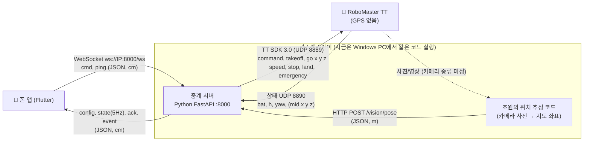
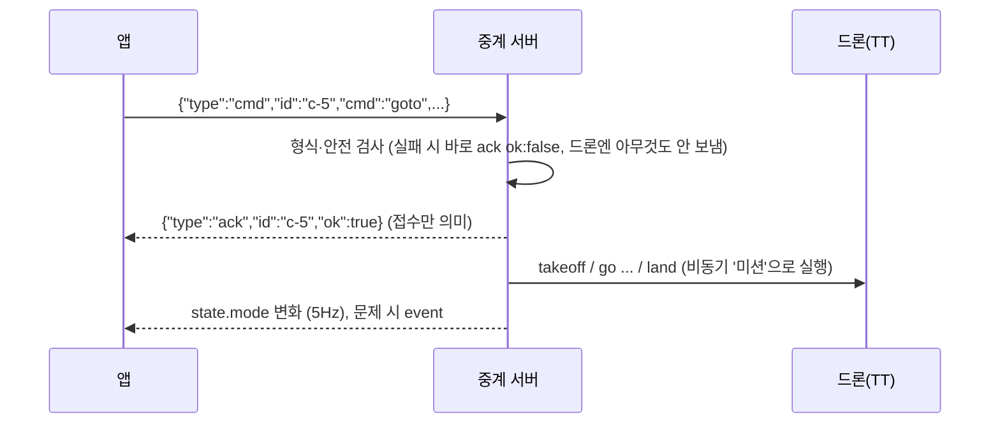

# 송수신 데이터 형식 — 라즈베리파이 담당 조원용

> **명세 v0.6 기준 · 작성일 2026-11-11**
> 대상: 라즈베리파이 쪽 드론 제어와 카메라 위치 추정을 맡은 조원 (이 앱·서버 코드를 처음 보는 사람)
> 기준: 앱⇄서버 명세 `docs/api.md` **v0.6**, 서버 코드 `server/drone_server/` (커밋 `863d42f`, `API_VERSION = "0.6"`)
> 이 문서는 **연동 형식을 맞추기 위한 공유용**이다. 바꾸고 싶은 점이 있으면 말해 주세요. 정식 명세는 `docs/api.md`가 기준이다.

근거 표기: `controller.py:212`는 `server/drone_server/controller.py`의 212번째 줄이다. (`backends/tello.py`도 `server/drone_server/` 아래)
줄 번호는 서버 커밋 `863d42f` 기준이다. 서버 코드가 바뀌면 조금 달라질 수 있다. 아직 풀리지 않은 문제는 6.2 "알려진 한계"에 모아 두었다.

---

## 목차
1. [전체 그림](#1-전체-그림)
2. [좌표·단위 약속](#2-좌표단위-약속)
3. [앱 → 라즈베리파이: 명령과 서버가 드론에 보내는 SDK 명령](#3-앱--라즈베리파이-명령과-서버가-드론에-보내는-sdk-명령)
4. [라즈베리파이 → 앱: config / state / ack / event](#4-라즈베리파이--앱-config--state--ack--event)
5. [위치 추정 코드 → 서버: `POST /vision/pose`](#5-위치-추정-코드--서버-post-visionpose)
6. [조원이 정해야 할 것 / 미정 사항 / 알려진 한계](#6-조원이-정해야-할-것--미정-사항--알려진-한계)
7. [드론 없이 빠르게 시험하기](#7-드론-없이-빠르게-시험하기)
8. [내 컴퓨터에서 서버 직접 돌려 보기 (Windows / macOS / Linux·라즈베리파이)](#8-내-컴퓨터에서-서버-직접-돌려-보기-windows--macos--linux라즈베리파이)
9. [부록: 설정값 한눈에 보기](#9-부록-설정값-한눈에-보기)

---

## 1. 전체 그림



| 보내는 쪽 → 받는 쪽 | 통로 | 내용 | 단위 | 자세히 |
|---|---|---|---|---|
| 앱 → 서버 | WebSocket `ws://<서버IP>:8000/ws` | 명령 `cmd` (출동·정지·착륙·귀환·비상정지), 생존 신호 `ping` (1초마다) | cm | 3장 |
| 서버 → 앱 | 같은 WebSocket | `config`(연결 직후 1회), `state`(약 5Hz), `ack`(명령마다), `event`(알림) | cm | 4장 |
| 위치 추정 코드 → 서버 | HTTP `POST http://<서버IP>:8000/vision/pose` | 추정한 드론 위치 (x, y, 선택: yaw, 신뢰도, 시각) | **m** | 5장 |
| 서버 → 드론 | djitellopy (TT SDK, UDP 8889) | `command`, `takeoff`, `go x y z speed`, `stop`, `land`, `emergency` | 기체 기준 cm | 3장 |
| 드론 → 서버 | TT 상태 패킷 (UDP 8890, 약 10Hz 읽음) | 배터리 `bat`, 높이 `h`, 방향 `yaw`, (미션패드 `mid`, `x`, `y`, `z`) | cm, ° | 3.9 |

- **앱은 위치를 계산하지 않는다.** 서버가 보낸 `state.pos`를 그대로 지도에 그린다. 위치 추정 결과도 서버를 거쳐 `state.pos`로 앱에 간다.
- 서버의 드론 쪽 연결(백엔드)은 3가지이고 서버 실행 인자로 고른다: `mock`(가짜 드론, Python만), `sim`(조원이 만든 Unity 시뮬레이터), `real`(실제 TT). 앱은 어느 것인지 몰라도 된다.

---

## 2. 좌표·단위 약속

### 2.1 지도 좌표계 (모든 위치의 기준)
```
 y (위쪽 +)
 250 ┌──────────────────────────┐ (250, 250)
     │                          │
     │        바닥 지도         │
     │      2.5 m × 2.5 m       │
     │                          │
     │                ● 정문(home)│
     │              (153.2, 70.2)│
   0 └──────────────────────────┘
     0 (원점=왼쪽 아래)        250  x (오른쪽 +)
```
- 원점 (0, 0): 지도를 정방향으로 놓았을 때 **왼쪽 아래 모서리** (아래가 0)
- x: 지도 오른쪽이 +, y: 지도 위쪽이 +, z: 바닥에서의 높이
- **yaw(방향)**: 도(°). 지도 위쪽(+y)을 보면 0°, **시계 방향이 +** (오른쪽(+x)을 보면 +90°). 서버는 -180 < yaw ≤ 180으로 맞춘다 (`positioning.py:255`)
- 지도 위쪽 ≈ 실제 북쪽(약 1° 회전)이지만, 서버·앱은 **지도 방향만** 쓴다.
- 조원 결과 화면 좌표계(2.5m×2.5m, 왼쪽 아래 원점, x 오른쪽, y 위쪽)와 **축 방향이 같고 단위만 다르다.**

### 2.2 단위 — 통로마다 다르다 ⚠️
| 통로 | 단위 | 예: 정문(home) |
|---|---|---|
| 앱 ⇄ 서버 (WebSocket) | **cm** | `{"x_cm": 153.2, "y_cm": 70.2}` |
| 위치 추정 코드 → 서버 (`/vision/pose`) | **m** | `{"x_m": 1.532, "y_m": 0.702}` |

서버가 받은 m 값에 ×100 해서 cm로 바꾼다 (`app.py:180`).

### 2.3 실제 드론의 방향 가정
- TT에는 GPS가 없어서 서버는 "지금 위치 → 목표" 차이를 **드론 기준 상대 이동**(`go`)으로 바꿔 보낸다.
- 이때 **드론을 home(정문)에 지도 위쪽(+y)을 보게 놓고 켠다**고 가정한다. 즉 TT 센서 yaw 0° = 지도 위쪽 (`positioning.py:27`, `server/README.md` 7장).
- 이동 계산에 쓰는 방향은 TT 센서의 `yaw`이다 (`backends/tello.py:227`). 위치 추정에서 보낸 `yaw_deg`는 앱 화면 표시에만 쓰인다 (5.4 참고).

---

## 3. 앱 → 라즈베리파이: 명령과 서버가 드론에 보내는 SDK 명령

### 3.1 공통 흐름

- 서버는 검사를 통과하면 **바로 `ack`(ok)를 보내고**, 실제 비행은 그 뒤 백그라운드 작업("미션")으로 실행한다 (`controller.py:147-161`, `controller.py:97-98`). 비행이 끝났는지는 `state.mode`로 본다.
- 새 명령이 접수되면 진행 중 미션은 취소된다 (`controller.py:88-95`). 미션 실행 중 오류가 나면 `event` `CMD_FAILED`를 보내고 mode를 `hovering`(날고 있으면) 또는 `idle`로 돌린다 (`controller.py:100-110`).
- **명령권**: 앱이 여러 개 연결되면 모두 `state`를 받지만, 명령은 **명령권을 가진 앱**(마지막에 연결한 앱)만 보낼 수 있다. 다른 앱의 `cmd`는 `BUSY` (`app.py:224`, `229-232`).
  새 앱이 연결하면 그 앱이 명령권을 갖고, 생존 신호 타이머를 새로 시작하며, 앱이 2개 이상이면 `event` `CONTROLLER_CHANGED`를 보낸다 (`app.py:190-193`).
- **명령권 넘겨받기 (명세 v0.6 1장)**: 명령권 앱의 연결이 끊기면, 남아 있는 앱 중 **가장 최근에 연결된 앱**이 즉시 명령권을 넘겨받는다. 서버는 넘겨받는 순간 생존 신호 타이머를 새로 시작하고(바로 자동 착륙하지 않도록) 모든 앱에 `CONTROLLER_CHANGED`를 보낸다 (`app.py:200-212`). 비행은 계속되며, 이후 생존 신호는 새 명령권 앱의 `ping`으로 판단한다. 남은 앱이 없으면 3.9의 자동 착륙.
- `cmd`를 받으면 그것도 생존 신호로 친다 (`app.py:233`).
- 공통 형식 오류: `id`가 없거나 빈 문자열이면 `BAD_REQUEST` (`controller.py:149-150`), 모르는 `cmd`면 `BAD_REQUEST` (`controller.py:152-153`), JSON이 아니면 `event` `BAD_REQUEST` (`app.py:215-222`).
- `id`는 앱이 정하는 문자열(현재 앱은 `"c-1"`, `"c-2"`, … `app/lib/drone_client.dart:222`).

### 3.2 서버 → 드론 SDK 명령의 공통 규칙 (실제 드론 = `real` 백엔드)
| 항목 | 내용 | 근거 |
|---|---|---|
| 라이브러리 | 진짜 `djitellopy`의 `Tello()` 1개로 명령과 상태 읽기를 함께 함 | `backends/real.py:37-68` |
| 연결 | `connect()` (SDK `command`). 실패하면 서버가 2초마다 재시도 | `backends/tello.py:104-121`, `app.py:89-97` |
| 미션패드 모드일 때만 | 연결 직후 `mon`, `mdirection 0`(아래쪽만) | `backends/real.py:53-55` |
| 이동 명령 | `go x y z speed` — **x=전진, y=왼쪽, z=위** (드론 기준, cm). speed = `[real] speed_cm_s` = **30** | `backends/tello.py:231-237` |
| 구간 길이 | 한 번에 최대 `[real] segment_cm` = **50 cm**. 남은 거리를 같은 길이로 나눈 첫 구간만 보내고, 끝나면 **위치를 다시 읽고** 다시 계산 (폐루프) | `backends/tello.py:42-59`, `224-242` |
| SDK 제한 처리 | x, y, z가 모두 ±20cm 미만이면 TT가 거부 → 남은 거리가 각 축 20cm 미만이면 **도착으로 봄**. 나눈 구간이 너무 짧으면 가장 큰 성분을 20cm로 키움. 한 번 최대 500cm | `backends/tello.py:25-26`, `49-57` |
| 명령 순서 | 비행 명령은 스레드 1개에서 하나씩 차례로 실행 (앞 명령의 응답을 기다림) | `backends/tello.py:92`, `182-193` |
| 상태 읽기 | 별도 스레드가 0.1초마다 `get_current_state()` 읽음. 2초 동안 못 읽으면 연결 끊김 | `backends/tello.py:25-28`, `141-149`, `170-171` |
| 비행 여부 | 실제 TT 상태에는 비행 여부가 없어서, 서버가 `takeoff`/`land`/`emergency`를 보낸 기록으로 판단 | `backends/tello.py:131-132`, `207`, `264`, `290` |

**이동 계산 순서** (`backends/tello.py:211-243`, `42-59`, `31-35`)
1. 현재 위치 `cur` = 위치 공급자의 값 (vision이 새로우면 카메라 위치, 아니면 명령 누적 추정)
2. 지도 변위 (목표 − 현재)를 TT 센서 yaw로 드론 기준 (전진, 오른쪽, 위)로 회전
3. 수평 거리와 높이차 중 큰 값 ÷ 50cm를 올림한 수 n으로 나눠 첫 구간을 정수 cm로
4. `go 전진 -오른쪽(=왼쪽) 위 30` 전송 → 끝나면 추정 위치에 그 구간을 더하고 상태를 다시 읽음
5. 1로 돌아감. 각 축 20cm 미만 남으면 끝. (안전용 최대 반복: 거리/50 + 10번)

**예: 정문 (153.2, 70.2)에서 80cm 높이로 호버링 중 → `goto (60, 200)`**, yaw 0°, 위치 추정 = 명령 누적 추정일 때
```
남은 (-93.2, +129.8) 거리 159.8 → n=4 → go 32 23 0 30   (전진 32, 왼쪽 23)
남은 (-70.2,  +97.8) 거리 120.4 → n=3 → go 33 23 0 30
남은 (-47.2,  +64.8) 거리  80.2 → n=2 → go 32 24 0 30
남은 (-23.2,  +32.8) 거리  40.2 → n=1 → go 33 23 0 30
남은 ( -0.2,   -0.2) → 각 축 20cm 미만 → 도착
```
카메라 위치(vision)가 들어오면 매 구간 시작 때 그 값을 현재 위치로 쓰므로 실제 드리프트가 보정된다.

### 3.3 `takeoff` — 이륙
앱이 보내는 JSON
```json
{ "type": "cmd", "id": "c-1", "cmd": "takeoff" }
```
> 현재 앱 화면에는 이륙 버튼이 없다. 출동(`goto`)이 착지 상태면 자동으로 이륙한다. 명세에는 있는 명령이다.

| 검사 (순서대로) | 결과 | 근거 |
|---|---|---|
| 드론 연결 안 됨 | `NOT_CONNECTED` | `controller.py:163-167`, `176` |
| 착륙 중 / 비상정지 중이면서 아직 비행 중 | `BUSY` | `controller.py:169-173`, `177` |
| 이미 이륙 중 또는 이미 비행 중 | ok (아무것도 안 함) | `controller.py:178-181` |
| 배터리 < `min_battery_pct`(20%) | `LOW_BATTERY` | `controller.py:182`, `safety.py:56-59` |

통과 시 드론에 가는 SDK 명령 (`controller.py:112-118`, `backends/tello.py:195-209`, `211-243`)
```
takeoff                     ← TT 기본 이륙 높이까지 상승
go 0 0 <dz> 30  (필요시)    ← 기본 고도 default_alt_cm(80)로 맞춤. 높이차가 20cm 미만이면 생략
```
mode: `idle` → `taking_off` → `hovering`

### 3.4 `goto` — 목표 지점으로 출동
앱이 보내는 JSON (현재 앱은 `z_cm`을 보내지 않음, `app/lib/drone_client.dart:234-235`)
```json
{ "type": "cmd", "id": "c-2", "cmd": "goto", "x_cm": 60, "y_cm": 200 }
{ "type": "cmd", "id": "c-3", "cmd": "goto", "x_cm": 60, "y_cm": 200, "z_cm": 100 }
```
- `z_cm` 생략 시: 날고 있으면 **현재 고도를 50~150cm 범위로 자른 값**, 착지 상태면 `default_alt_cm`(80) (`controller.py:200-201`, `safety.py:62-63`)

| 검사 (순서대로) | 결과 | 근거 |
|---|---|---|
| `x_cm`, `y_cm`가 숫자가 아님 / `z_cm`이 숫자가 아님 | `BAD_REQUEST` | `controller.py:189-198` |
| 드론 연결 안 됨 | `NOT_CONNECTED` | `controller.py:199` |
| 지도 밖 (0~250, 0~250 cm) | `OUT_OF_BOUNDS` | `safety.py:35-36` |
| 금지 구역 안 (현재 설정에는 금지 구역 없음) | `NO_FLY_ZONE` | `safety.py:37-39` |
| home에서 `max_radius_cm`(250)보다 멂 | `TOO_FAR` | `safety.py:40-41` |
| 고도가 50~150cm 밖 | `ALT_LIMIT` | `safety.py:42-44` |
| 현재 위치→목표 직선이 금지 구역 통과 | `NO_FLY_ZONE` | `safety.py:46-53` |
| 착륙 중 / 비상정지 중이면서 비행 중 | `BUSY` | `controller.py:204` |
| 이륙 중 | `BUSY` | `controller.py:205-206` |
| 배터리 < 20% | `LOW_BATTERY` | `controller.py:207` |

통과 시 (`controller.py:208-212`, `120-128`)
- 진행 중 미션(이전 goto, 귀환 등)을 **취소**하고 새 목표로 간다.
- 착지 상태였다면 먼저 `takeoff` (이 경우 고도 맞춤 `go 0 0 dz`를 따로 하지 않고 아래 이동에 합쳐짐)
- 그 다음 3.2의 방식으로 `go x y z 30`을 구간마다 반복 (높이 변화도 같은 `go`의 z로 함께)

```
(착지 상태였으면) takeoff
go <전진> <왼쪽> <위> 30     ← 최대 50cm, 끝날 때마다 위치 다시 읽고 재계산
go ...
(각 축 20cm 미만 남으면 끝, 그 자리 호버링)
```
mode: 착지 상태였으면 `idle` → `taking_off` → `moving` → `hovering` / 날고 있었으면 → `moving` → `hovering`
`state.target`은 이동하는 동안 `{"x_cm":60,"y_cm":200}`, 도착하면 `null`

### 3.5 `stop` — 그 자리에서 호버링
```json
{ "type": "cmd", "id": "c-4", "cmd": "stop" }
```
| 검사 | 결과 | 근거 |
|---|---|---|
| 드론 연결 안 됨 | `NOT_CONNECTED` | `controller.py:215` |
| 착륙 중 | `BUSY` | `controller.py:216-217` |
| 착지 상태 / 비상정지 상태 | ok (미션만 취소, 드론엔 아무것도 안 보냄) | `controller.py:218-222` |

통과 시 (`controller.py:214-222`, `142-144`, `backends/tello.py:249-252`, `backends/real.py:59-60`)
```
stop      ← SDK 3.0 'stop'을 응답 기다리지 않고 바로 보냄 (진행 중인 go를 끊고 제자리 호버링)
          ← 그 다음 진행 중이던 명령 스레드가 끝나길 기다림
```
mode: 즉시 `hovering` (`controller.py:221`)
> 시뮬레이터(`sim`)는 진행 중 이동을 끊을 수 없어서 한 구간이 끝난 뒤 멈춘다 (`backends/sim.py:79`).

### 3.6 `land` — 그 자리에 착륙
```json
{ "type": "cmd", "id": "c-5", "cmd": "land" }
```
| 검사 | 결과 | 근거 |
|---|---|---|
| 드론 연결 안 됨 | `NOT_CONNECTED` | `controller.py:225` |
| 이미 착륙 중 / 비상정지 상태 / 착지 상태 | ok (아무것도 안 함) | `controller.py:226-227` |

통과 시 (`controller.py:228-230`, `130-134`, `backends/tello.py:254-265`)
```
stop      ← 진행 중 이동 끊기 (응답 안 기다림)
          ← 진행 중 명령이 끝나길 기다림
land
```
(시뮬레이터는 `land` 전에 `go 0 0 -d`로 먼저 내려오지만, `real`은 `land_descend_to_cm`=0이라 바로 `land` — `backends/tello.py:267-271`)
mode: 즉시 `landing` → 착지 후 `idle`
> `land`는 배터리 검사를 하지 않는다 (배터리가 낮아도 착륙은 받음).

### 3.7 `return_home` — 정문으로 돌아와 착륙
```json
{ "type": "cmd", "id": "c-6", "cmd": "return_home" }
```
| 검사 | 결과 | 근거 |
|---|---|---|
| 드론 연결 안 됨 | `NOT_CONNECTED` | `controller.py:233` |
| 착륙 중 / 비상정지 중이면서 비행 중 | `BUSY` | `controller.py:234` |
| 착지 상태 | ok + `event` info `ALREADY_LANDED` | `controller.py:235-237` |
| 이륙 중 | `BUSY` | `controller.py:238-239` |

통과 시 (`controller.py:240-243`, `136-140`)
- 고도 = 현재 고도를 50~150cm로 자른 값 (위치를 모르면 80)
```
go ... 30     ← home(153.2, 70.2)까지 3.2 방식으로 구간 이동
go ...
stop          ← land 처리의 일부 (3.6과 같음)
land
```
mode: 즉시 `returning` (target = home) → 도착하면 `landing` → `idle`
> 배터리 검사 없음. 귀환 중 새 `goto`가 오면 귀환을 취소하고 그 목표로 간다.

### 3.8 `emergency` — 비상 모터 정지 (추락)
```json
{ "type": "cmd", "id": "c-7", "cmd": "emergency", "confirm": true }
```
| 검사 | 결과 | 근거 |
|---|---|---|
| `confirm`이 `true`가 아님 | `NOT_CONFIRMED` | `controller.py:246-247` |
| 드론 연결 안 됨 | `NOT_CONNECTED` | `controller.py:248` |

통과 시 (`controller.py:249-256`, `backends/tello.py:285-290`)
- 진행 중 미션을 취소만 하고 **기다리지 않는다.** 명령 스레드도 거치지 않고 바로 보낸다.
```
emergency     ← 모터 즉시 정지
```
- mode: `emergency`, `event` warn `EMERGENCY_STOP`
- 앱은 확인창에서 한 번 더 누른 경우에만 보낸다.
- 비상정지 뒤 착지 상태면 다시 `goto`/`takeoff`를 받는다 (`controller.py:172`는 "비상정지 중이면서 비행 중"만 거부).

### 3.9 `ping` — 생존 신호 (앱이 1초마다)
```json
{ "type": "ping", "ts": 1763000000.5 }
```
- 응답은 없다. **명령권을 가진 앱**의 ping(과 cmd)만 생존 신호로 친다 (`app.py:224-228`, `233`).
- 서버 감시 루프(0.2초마다, `controller.py:259-298`):
  - 비행 중인데 **명령권 앱**에게서 `link_timeout_s`(**3초**) 동안 ping/cmd가 없으면 → `event` warn `LINK_LOST_LANDING` + 3.6과 같은 착륙 (`controller.py:270-277`)
  - 명령권 앱이 끊겨도 다른 앱이 남아 있으면 명령권이 그 앱으로 넘어가고 타이머가 새로 시작되며(3.1, `app.py:205-208`), 그 앱의 ping으로 판단한다. **남은 앱이 하나도 없으면** 타이머가 새로 시작되지 않으므로, 마지막 생존 신호 뒤 3초가 지나 자동 착륙한다 (명세 v0.6 4.2, `controller.py:270-277`).
  - 비행 중 배터리 < 20% → `event` warn `LOW_BATTERY` (착지할 때까지 1번만) (`controller.py:279-285`)
  - 드론 연결이 바뀌면 → `DRONE_CONNECTED`(info) / `DRONE_DISCONNECTED`(error) (`controller.py:261-266`)
  - 미션이 없는데 드론이 착지 상태가 되면 mode를 `idle`로 (`controller.py:288-290`)

### 3.10 명령별 요약
| cmd | 거부될 수 있는 오류 | 드론에 가는 SDK 명령 (real) | mode 변화 |
|---|---|---|---|
| `takeoff` | NOT_CONNECTED, BUSY, LOW_BATTERY | `takeoff` → (`go 0 0 dz 30`) | idle → taking_off → hovering |
| `goto` | BAD_REQUEST, NOT_CONNECTED, OUT_OF_BOUNDS, NO_FLY_ZONE, TOO_FAR, ALT_LIMIT, BUSY, LOW_BATTERY | (`takeoff`) → `go x y z 30` × 여러 번 | (taking_off →) moving → hovering |
| `stop` | NOT_CONNECTED, BUSY(착륙 중) | `stop` | hovering |
| `land` | NOT_CONNECTED | `stop` → `land` | landing → idle |
| `return_home` | NOT_CONNECTED, BUSY | `go ...` × 여러 번 → `stop` → `land` | returning → landing → idle |
| `emergency` | NOT_CONFIRMED, NOT_CONNECTED | `emergency` | emergency |
| (ping 3초 끊김) | — | `stop` → `land` | landing → idle |

---

## 4. 라즈베리파이 → 앱: config / state / ack / event

연결하면 `config` 1회 → `state` 1회 → 그 뒤 `state`를 `[server] state_hz`(5Hz)로 계속 보낸다 (`app.py:183-189`, `99-107`).
정수인 숫자는 JSON 정수로 보낸다 (`250.0` → `250`, `app.py:47-55`).

### 4.1 `config` — 연결 직후 1회 (`app.py:26-44`)
```json
{
  "type": "config",
  "api_version": "0.6",
  "map": { "width_cm": 250, "height_cm": 250 },
  "home": { "x_cm": 153.2, "y_cm": 70.2 },
  "limits": {
    "max_radius_cm": 250, "min_alt_cm": 50, "max_alt_cm": 150,
    "default_alt_cm": 80, "min_battery_pct": 20, "link_timeout_s": 3
  },
  "no_fly_zones": [],
  "geo": {
    "sw": { "lat": 36.363927, "lon": 127.3589258 },
    "se": { "lat": 36.3640364, "lon": 127.3669092 },
    "nw": { "lat": 36.3703837, "lon": 127.3587905 },
    "ne": { "lat": 36.3704931, "lon": 127.3667739 },
    "rotation_deg": 0.97
  },
  "backend": "real"
}
```
- `api_version`: 서버가 따르는 명세 버전 (명세 3.1).
- 값은 모두 `config/settings.toml`에서 온다. `geo`는 앱이 화면에 위도·경도를 보여 줄 때만 쓴다.
- `backend`: `mock` · `sim` · `real`

### 4.2 `state` — 약 5Hz (`controller.py:65-77`)
```json
{
  "type": "state",
  "ts": 1763000000.123,
  "connected": true,
  "flying": true,
  "mode": "moving",
  "pos": { "x_cm": 120.5, "y_cm": 88.0, "z_cm": 80.0, "yaw_deg": 0.0 },
  "pos_source": "vision",
  "target": { "x_cm": 60, "y_cm": 200 },
  "battery_pct": 76
}
```
| 필드 | 뜻 | 어디서 오나 |
|---|---|---|
| `ts` | 서버 시각 (유닉스 초) | 서버 |
| `connected` | 서버가 드론과 통신 중인지 (최근 2초 안에 상태를 읽었는지) | `backends/tello.py:171` |
| `flying` | 날고 있는지 (real은 서버가 보낸 명령 기록 기준) | 3.2 |
| `mode` | `idle` · `taking_off` · `hovering` · `moving` · `returning` · `landing` · `emergency` | 3장 |
| `pos` | 지도 좌표 cm, 소수 1자리. 모르면 `null` | 위치 공급자 (`models.py:13-20`) |
| `pos.z_cm` | 높이. **항상 TT 센서 `h`** (위치 추정 값에는 높이가 없음) | `positioning.py:108-111`, `197-198` |
| `pos.yaw_deg` | 방향. vision이 새롭고 `yaw_deg`를 보냈으면 그 값, 아니면 TT 센서 `yaw` | `positioning.py:196-198` |
| `pos_source` | 위치를 어디서 얻었는지 (아래 표) | `positioning.py:187-189` |
| `target` | 이동/귀환 중인 목표. 아니면 `null` | 컨트롤러 |
| `battery_pct` | TT `bat` (정수 %). 모르면 `null` | `backends/tello.py:172` |

`pos_source` 값
| 값 | 뜻 | 앱 표시 |
|---|---|---|
| `vision` | **조원의 카메라 위치 추정** 값이 `stale_s`(1초) 안에 들어옴 | "카메라" (초록) |
| `estimate` | 보낸 이동 명령을 더해 간 추정 (드리프트가 쌓임) | 추정 (주황) |
| `mission_pad` | TT 미션패드 측정 | 초록 |
| `sim_truth` | 시뮬레이터 참값 (디버그용) | 초록 |

### 4.3 `ack` — 명령마다 1회 (`controller.py:27-32`)
```json
{ "type": "ack", "id": "c-2", "ok": true }
{ "type": "ack", "id": "c-3", "ok": false, "error": "OUT_OF_BOUNDS", "message": "지도 경계 밖 좌표입니다" }
```
- "접수했다"는 뜻일 뿐 비행 완료가 아니다. 성공이면 `error`/`message` 키가 없다.
- 오류 코드: `OUT_OF_BOUNDS`, `NO_FLY_ZONE`, `TOO_FAR`, `ALT_LIMIT`, `LOW_BATTERY`, `NOT_CONNECTED`, `BUSY`, `NOT_CONFIRMED`, `BAD_REQUEST`

### 4.4 `event` — 알림 (`controller.py:35-36`)
```json
{ "type": "event", "level": "warn", "code": "LINK_LOST_LANDING", "message": "앱 연결이 3초 이상 끊겨 자동 착륙합니다" }
```
| code | level | 언제 |
|---|---|---|
| `LINK_LOST_LANDING` | warn | 비행 중 명령권 앱의 ping 3초 끊김 (남은 앱이 없을 때 포함) → 자동 착륙 |
| `EMERGENCY_STOP` | warn | 비상정지 실행 |
| `LOW_BATTERY` | warn | 비행 중 배터리 < 20% |
| `DRONE_CONNECTED` / `DRONE_DISCONNECTED` | info / error | 드론 연결 변화 |
| `CMD_FAILED` | error | 접수된 명령이 실행 중 실패 (예: TT가 `go`에 error 응답) |
| `CONTROLLER_CHANGED` | info | 다른 앱이 새로 연결해 명령권이 넘어감, 또는 명령권 앱이 끊겨 남은 최근 앱이 넘겨받음 (v0.6, `app.py:205-212`) |
| `ALREADY_LANDED` | info | 착지 상태에서 `return_home` |
| `BAD_REQUEST` | error | 앱이 JSON이 아닌 메시지를 보냄 |

---

## 5. 위치 추정 코드 → 서버: `POST /vision/pose`

> 구현: 서버 커밋 `79b4f36` (`app.py:145-181`, `positioning.py:145-207`, `server/tools/fake_vision.py`). 서버 쪽 사용법은 `server/README.md` 3장.

### 5.1 보내는 형식
```
POST http://<서버 IP>:8000/vision/pose
Content-Type: application/json
```
- 위치 추정 코드와 서버가 **같은 라즈베리파이**면 `http://127.0.0.1:8000/vision/pose`
```json
{ "x_m": 1.532, "y_m": 0.702, "yaw_deg": 0.0, "confidence": 0.92, "ts": 1763000000.12 }
```
| 필드 | 필수 | 단위·범위 | 서버가 하는 일 | 근거 |
|---|---|---|---|---|
| `x_m` | ✅ | m, 지도 왼쪽이 0, 오른쪽 + (0~2.5) | ×100 → `pos.x_cm` | `app.py:168`, `180` |
| `y_m` | ✅ | m, 지도 **아래가 0**, 위쪽 + (0~2.5) | ×100 → `pos.y_cm` | 〃 |
| `yaw_deg` | | °, 지도 위쪽 0, 시계방향 + | 앱의 `pos.yaw_deg` 표시에만 사용. 없으면 TT 센서 yaw | `positioning.py:196-198` |
| `confidence` | | 0~1 | `[vision] min_confidence`(현재 0.0)보다 낮으면 거부 | `app.py:172-179` |
| `ts` | | 사진 찍은 시각, 유닉스 초 (`time.time()`) | **순서 확인에만** 사용: 이전에 받은 `ts`보다 오래된 값은 버림 | `positioning.py:166-170` |

- 숫자는 JSON 숫자(정수 또는 실수)여야 한다. 문자열 `"1.5"`나 `true`는 `BAD_REQUEST` (`app.py:157-165`).
- 높이(z)는 보내지 않는다. 높이는 TT 센서 `h`를 쓴다.

### 5.2 응답
```json
{ "ok": true }
```
```json
{ "ok": false, "error": "OUT_OF_BOUNDS", "message": "지도(2.5m x 2.5m, 여유 0.1m) 밖 좌표입니다" }
```
| HTTP | `error` | 언제 | 근거 |
|---|---|---|---|
| 200 | — | 접수 | `app.py:181` |
| 400 | `BAD_REQUEST` | 서버의 vision 입력이 꺼져 있음 (아래 5.5), JSON 아님, 필수 필드 없음, 숫자가 아님, `confidence`가 0~1 밖 | `app.py:148-173` |
| 400 | `OUT_OF_BOUNDS` | x, y가 -0.1 ~ 2.6 m 밖 (`[vision] margin_m` = 0.1 m 여유) | `app.py:174-177` |
| 400 | `LOW_CONFIDENCE` | `confidence` < `min_confidence` | `app.py:178-179` |

- `ts`가 이전 값보다 오래돼 버려진 경우에도 응답은 `{"ok": true}`이다 (명세 7.2, `app.py:180-181`). 응답이 ok여도 순서가 뒤바뀐 값은 반영되지 않는다.

### 5.3 서버가 위치를 쓰는 방식 (`positioning.py:145-207`)
```
값 도착 ──► 최근 값으로 저장 + 명령 누적 추정의 기준점도 이 위치로 맞춤
             │
   마지막 값 받은 지 ≤ stale_s(1.0초)  ──► pos = 카메라 위치,  pos_source = "vision"
   마지막 값 받은 지 >  stale_s        ──► pos = 마지막 카메라 위치 + 그 뒤 보낸 go 명령 누적,
                                              pos_source = "estimate"
```
- 서버는 **가장 최근 값 하나만** 쓴다. 평균·필터링은 하지 않는다 → 튀는 값을 거르는 일은 위치 추정 코드 쪽에서 해 주세요.
- "얼마나 오래됐나"는 `ts`가 아니라 **서버가 받은 시각** 기준이다 (`positioning.py:172`, `179-185`).
- 이동 중에는 **각 `go` 구간(최대 50cm)을 시작할 때마다** 현재 위치를 다시 읽는다 (3.2). 그래서 위치 값이 구간 사이에 들어와 있으면 다음 구간 계산이 보정된다.
- 상태 확인: 브라우저로 `http://<서버IP>:8000/` → `"vision": {"enabled": true, "last_age_s": 0.12, "stale_s": 1.0}` (마지막 값이 몇 초 전인지) (`app.py:130-140`)

### 5.4 알아 둘 점
- **권장 빈도: 1초에 2번 이상** (명세 7.2). `stale_s`(1초) 안에 값이 계속 들어와야 앱에 `vision`으로 표시된다. 더 느리게 보낼 수밖에 없으면 `[vision] stale_s`를 늘린다.
- 카메라가 추정한 `yaw_deg`는 **앱 화면 표시용**이다. 이동 방향 계산에는 TT 센서 yaw를 쓴다 (명세 7.2, `backends/tello.py:227`).
- 좌표가 지도 밖(여유 0.1m 넘게)이면 거부되므로, 드론이 지도 가장자리 밖으로 살짝 나간 경우 그 값은 서버에 반영되지 않는다.

### 5.5 서버에서 vision 입력 켜기
`POST /vision/pose`는 백엔드의 `pos_source`가 `"vision"`일 때만 받는다 (`backends/real.py:24-25`, `backends/sim.py:62-63`, `backends/mock.py:31-32`).
- 실제 드론: `config/settings.toml`의 `[real] pos_source = "vision"` 또는 실행할 때 `--vision`
  ```
  .venv/bin/python run_server.py real --vision
  ```
- 시험용 가짜 드론: `run_server.bat mock --vision` (7장)

### 5.6 Python 예시 (`requests`)
```python
import time
import requests

SERVER = "http://127.0.0.1:8000"   # 같은 라즈베리파이면 127.0.0.1, 아니면 서버 IP

def send_pose(x_m, y_m, yaw_deg=None, confidence=None, ts=None):
    body = {"x_m": float(x_m), "y_m": float(y_m), "ts": ts if ts is not None else time.time()}
    if yaw_deg is not None:
        body["yaw_deg"] = float(yaw_deg)
    if confidence is not None:
        body["confidence"] = float(confidence)
    try:
        r = requests.post(SERVER + "/vision/pose", json=body, timeout=1.0)
        return r.json()            # {"ok": true} 또는 {"ok": false, "error": ..., "message": ...}
    except requests.RequestException as e:
        return {"ok": False, "error": "CONNECTION", "message": str(e)}

# 예: 사진을 찍은 시각을 기록해 두고, 추정이 끝나면 그 시각과 함께 보낸다
t_photo = time.time()
x, y = 1.532, 0.702                # ← 조원의 추정 결과 (m, 왼쪽 아래 원점)
print(send_pose(x, y, confidence=0.9, ts=t_photo))
```
- 표준 라이브러리만으로 보내는 버전은 `server/tools/fake_vision.py`의 `send_pose()` 함수 (복사해서 써도 된다).
- `ts`는 위치 추정 코드와 서버가 **같은 기기**가 아니면 시계가 다를 수 있다. 지금은 순서 확인에만 쓰므로 같은 송신기에서 늘 같은 시계로 보내면 문제없다.

---

## 6. 조원이 정해야 할 것 / 미정 사항 / 알려진 한계

### 6.1 정해야 할 것 / 미정 사항

| # | 항목 | 지금 상태 | 왜 중요한가 | 근거 |
|---|---|---|---|---|
| 1 | **위치 반환 빈도** (1초에 몇 번) | 미정. 명세 권장 **2Hz 이상**, 서버 `stale_s` = 1.0초 [임시] | 1초보다 드물면 대부분 `estimate`로 표시되고 명령 누적으로 이어 감. 빈도에 맞춰 `stale_s`를 정해야 함 | `CLAUDE.md` 카메라 연동, `settings.toml:133` |
| 2 | **지연 시간** (사진 촬영 → 서버 도착) | 미정 | 서버는 받은 시각 기준으로 쓰므로, 지연이 크면 이동 중 위치가 뒤처짐 | 5.3 |
| 3 | **보내는 필드** (yaw, confidence, ts 포함 여부) | 선택 필드로 열어 둠 | confidence를 보내면 `min_confidence`로 거를 수 있음 | 5.1 |
| 4 | **카메라 종류** | 미정: TT 전방 카메라 / TT 하방 카메라(`downvision`) / 별도 카메라 | TT 카메라면 영상 스트림을 서버 쪽 TT 연결과 함께 써야 함 (아래 7번) | `CLAUDE.md` |
| 5 | **위치 추정 코드 실행 위치** | 미정. 같은 라즈베리파이 권장 (`127.0.0.1`) | 다른 기기면 서버 IP, 방화벽, 시계 차이 고려 | 5.1 |
| 6 | **라즈베리파이 네트워크** | TT Wi-Fi(드론 AP) + 폰 핫스팟, Wi-Fi 2개 또는 유선 필요 | 서버는 TT와 앱 양쪽에 동시에 닿아야 함 | `server/README.md` 7장 |
| 7 | **TT 연결 공유** | 서버가 TT SDK(UDP 8889, 상태 8890)를 쓰고 있음 | TT 카메라 영상(`streamon`, UDP 11111)을 위치 추정 코드가 직접 열면 서버와 충돌할 수 있음 → 누가 `streamon`을 보낼지 정해야 함 | `backends/real.py` |
| 8 | **미션패드 병행** | 서버에 단순 버전 있음 (`pos_source = "mission_pad"`), 미검증 | 카메라 추정과 함께 쓸지, 대체로 쓸지 | `positioning.py` MissionPadProvider, `server/README.md` 7장 |
| 9 | **드론 시작 자세** | 서버는 "home(정문)에 지도 위쪽을 보게 놓고 켬"을 가정 | 이 가정이 틀리면 첫 이동 방향이 틀어짐. 카메라로 처음 위치·방향을 잡을 수 있는지 | 2.3 |
| 10 | **속도·구간 길이** | speed 30cm/s, 구간 50cm [임시] | 구간이 짧을수록 위치 보정이 자주 되지만 `go` 명령 수가 늘어남 | `settings.toml:119-120` |
| 11 | **천장 높이 / 고도 제한** | 50~150cm, 기본 80cm [임시] | 하방 카메라 사용 시 고도에 따라 시야가 바뀜 | `settings.toml:25-27` |

### 6.2 알려진 한계 (아직 해결 안 됨)

| # | 한계 | 영향 | 해결 방향 (제안) | 근거 |
|---|---|---|---|---|
| A | **real 백엔드 실기체 미검증** | 실제 TT에서 한 번도 돌려 보지 않았다. 특히 `stop`이 진행 중인 `go`를 실제로 끊는지, `go` 응답 시간이 얼마인지 모른다 | 처음엔 프로펠러 가드, 낮은 `max_alt_cm`, 짧은 거리로 시험 | `server/README.md` 7장, `backends/real.py:1-7` |
| B | **TT 자동 착륙 감지 안 됨** | real은 비행 여부를 서버가 보낸 명령(`takeoff`/`land`/`emergency`) 기록으로만 판단하고, TT 상태의 `h`/`tof`는 쓰지 않는다. 저전압 자동 착륙 등 TT가 스스로 내려앉으면 앱에는 계속 "비행 중"으로 보인다 | TT 상태의 `tof`/`h`로 착지를 판단 | `backends/tello.py:131-132`, 3.2 |
| C | **이동 방향은 TT yaw 센서에만 의존** | 카메라 `yaw_deg`는 표시용이라, TT yaw가 틀어지면(시작 자세 오류, 드리프트) 이동 방향도 틀어진다. 위치는 구간마다 다시 보정되지만 방향은 보정되지 않는다 | 카메라 yaw가 믿을 만하면 이동 계산에도 쓰도록 협의 | 명세 7.2, `backends/tello.py:227`, 2.3 |
| D | **도착 오차 약 20cm** | TT `go`는 각 축 20cm 미만 이동을 거부해서, 목표에서 최대 약 20cm 벗어나 멈출 수 있다 | 2.5m 지도에서 허용할지 결정. 더 줄이려면 `rc` 명령 등 다른 방식 필요 | 명세 4.1, `backends/tello.py:25`, `49-50` |

---

## 7. 드론 없이 빠르게 시험하기

드론·Unity 없이 **가짜 드론(mock) + 가짜 위치 송신 + 앱**으로 연동 형식을 확인한다.
아래는 Windows 기준 요약이다. **처음 설치하는 방법과 macOS/Linux·라즈베리파이 명령은 8장**에 단계별로 있다.

**① 서버 켜기 (vision 입력 켬)** — PowerShell 창 1 (`조원공유\server` 폴더에서)
```
.\run_server.bat mock --vision
```
화면에 `위치 입력(vision) 켜짐: POST http://<이 PC IP>:8000/vision/pose`가 나오면 준비 완료.
(처음 실행이면 가상환경을 만드느라 1~2분 걸린다. 방화벽 창이 뜨면 "개인 네트워크" 허용.)

**② 가짜 위치 보내기** — PowerShell 창 2 (`조원공유\server` 폴더에서)
```
.venv\Scripts\python.exe tools\fake_vision.py --pattern circle
```
- `[1] (1.750, 1.250) m → 서버 수신 OK` 처럼 나오면 서버가 받은 것이다.
- 다른 패턴:
  - 한 점 고정: `tools\fake_vision.py` (기본 정문 1.532, 0.702)
  - 지점 순회: `tools\fake_vision.py --pattern waypoints --points "1.5,0.7 0.6,2.0 2.2,0.4"`
  - 잡음·신뢰도: `tools\fake_vision.py --pattern circle --noise 0.03 --confidence 0.8`
  - 거부 확인: `tools\fake_vision.py --outside` → `OUT_OF_BOUNDS`
  - 다른 기기에서: `--url http://192.168.0.10:8000 --hz 2`

**③ 확인**
- 브라우저 `http://127.0.0.1:8000/` → `"vision": {"enabled": true, "last_age_s": 0.1...}`, `"pos_source": "vision"`
- 폰 앱(`경비드론.apk`, 8.7)을 `ws://<PC IP>:8000/ws`로 연결 → 지도 위 드론 아이콘이 원을 그리며 움직이고 위치 출처가 "카메라"(초록)로 표시
- 창 2를 `Ctrl+C`로 끄면 약 1초 뒤 `pos_source`가 `estimate`(주황)로 바뀌고 마지막 위치에 멈춘다
- 앱 없이 명령 흐름만 보려면 창 3에서 `.venv\Scripts\python.exe tools\ws_check.py` (goto → 귀환 → 착륙까지 출력)

**④ 조원 코드 연결**: ②의 `fake_vision.py` 대신 조원의 위치 추정 코드가 같은 주소로 보내면 된다 (5.6 예시).

다음 단계(시뮬레이터): Unity `UnityProject.exe`를 켜고 `.\run_server.bat sim --vision` (8.6). 실제 드론: 라즈베리파이에서 `run_server.py real --vision` (8.6, `server/README.md` 7장).

---

## 8. 내 컴퓨터에서 서버 직접 돌려 보기 (Windows / macOS / Linux·라즈베리파이)

받은 압축 파일만으로 조원 PC에서 중계 서버를 켜고, 가짜 위치를 보내고, 폰 앱을 붙여 보는 방법이다.
명령 앞의 `>`나 `$`는 입력하지 않는다. 각 명령은 근거 파일을 확인한 실제 파일·옵션만 썼다.

### 8.1 압축 파일 구조 — 폴더 구조를 바꾸지 말 것
```
조원공유/
  먼저_읽어주세요.txt
  docs/teammate/interface.md   ← 이 문서
  docs/api.md                  ← 앱⇄서버 명세
  server/                      ← 중계 서버 (Python)
  config/settings.toml         ← 서버 설정 (지도 크기, 고도 제한, 포트 …)
  경비드론.apk                 ← 안드로이드 앱
```
- 서버는 설정 파일을 **`server` 폴더의 한 단계 위 폴더 기준 `config/settings.toml`**에서 읽는다 (`server/drone_server/settings.py:14-15`).
  그래서 `server/`와 `config/`가 **같은 부모 폴더(`조원공유/`) 안에** 있어야 한다. `server`만 따로 옮기면 설정 파일을 못 찾는다.
  다른 위치의 설정을 쓰려면 `--config <settings.toml 경로>` 옵션을 쓴다 (`server/run_server.py:45`).
- 아래 명령은 모두 **`조원공유/server` 폴더 안에서** 실행한다.

### 8.2 Python 준비 — **3.11 이상** 필요
- 서버가 TOML 읽기에 Python 3.11부터 들어 있는 `tomllib`를 쓰므로 **3.10 이하는 시작하자마자 실패**한다 (`server/drone_server/settings.py:9`).
- 권장: **3.12 또는 3.13**. 사용자 PC는 3.14로 시험했고 테스트 70개가 통과했다 (2026-11-11).
- `requirements.txt`의 `numpy`, `opencv-python`은 **sim 모드 전용**이다. 설치가 안 되면 빼고 설치해도 mock·real은 동작한다(8.3의 ⚠ 참고). sim 모드도 두 패키지가 없으면 서버가 빈 모듈로 대신해 제어는 된다 (`server/drone_server/backends/sim.py:28-34`).

| OS | 설치 | 확인 |
|---|---|---|
| Windows | https://www.python.org/downloads/ 에서 3.12/3.13 설치. 설치 첫 화면에서 **"Add python.exe to PATH" 체크** (`py` 실행기도 함께 설치됨) | PowerShell에서 `py -0` (설치된 버전 목록), `py -3.13 --version` |
| macOS | python.org 설치 파일, 또는 Homebrew `brew install python@3.13` | 터미널에서 `python3 --version` |
| Linux / 라즈베리파이 | Raspberry Pi OS **Bookworm** 이상은 기본 Python 3.11 → 그대로 사용. (Bullseye는 3.9라 안 됨 → OS 업데이트 필요) `sudo apt install python3-venv` | `python3 --version` |

### 8.3 처음 한 번: 가상환경 만들고 패키지 설치

**Windows** — 가장 쉬운 방법: `server` 폴더에서 `run_server.bat`을 쓰면 **처음 실행할 때 가상환경(`.venv`) 생성과 설치를 자동으로** 한다.
`run_server.bat`은 `py -3.14`로 만들고, 없으면 `py -3`(설치된 최신 버전)으로 만든 뒤 `pip install -r requirements.txt`를 한다 (`server/run_server.bat:6-10`).
직접 하려면 (PowerShell, `조원공유\server`에서):
```
py -3.13 -m venv .venv
.venv\Scripts\python.exe -m pip install -r requirements.txt
```

**macOS / Linux / 라즈베리파이** (터미널, `조원공유/server`에서). `run_server.bat`은 Windows 전용이라 직접 만든다:
```
python3 -m venv .venv
.venv/bin/python -m pip install -r requirements.txt
```

⚠ `opencv-python`/`numpy` 설치가 실패하거나 너무 오래 걸리면(32비트 라즈베리파이 등) 필요한 것만 설치한다:
```
.venv/bin/python -m pip install "fastapi>=0.110" "uvicorn[standard]>=0.29" "websockets>=12" "pytest>=8" "httpx>=0.27"
```
(Windows는 `.venv/bin/python` 대신 `.venv\Scripts\python.exe`)

### 8.4 서버 실행 (mock / mock --vision)
| 하고 싶은 것 | Windows (PowerShell) | macOS / Linux |
|---|---|---|
| 가짜 드론 | `.\run_server.bat mock` | `.venv/bin/python run_server.py mock` |
| 가짜 드론 + 카메라 위치 입력 | `.\run_server.bat mock --vision` | `.venv/bin/python run_server.py mock --vision` |
| 설정 파일 값대로 (`[backend] mode`, 현재 `"sim"`) | `.\run_server.bat` | `.venv/bin/python run_server.py` |
| 다른 포트 | `.\run_server.bat mock --port 8001` | `.venv/bin/python run_server.py mock --port 8001` |

- `run_server.bat`은 인자를 그대로 `run_server.py`에 넘긴다 (`server/run_server.bat:11`). 옵션: 백엔드 `mock|sim|real`, `--vision`, `--config`, `--host`, `--port` (`server/run_server.py:43-49`).
- 켜지면 이런 안내가 나온다 (`server/run_server.py:66-76`). **"앱에 입력할 주소"**를 폰 앱에 넣는다(8.7).
  ```
  ============================================================
   드론 중계 서버  backend=mock
   설정 파일: .../조원공유/config/settings.toml
   앱에 입력할 주소:
     ws://192.168.0.23:8000/ws
   확인용(브라우저): http://127.0.0.1:8000/
   위치 입력(vision) 켜짐: POST http://<이 PC IP>:8000/vision/pose  (tools/fake_vision.py로 시험)
   끄려면 이 창에서 Ctrl+C
  ============================================================
  ```
- **확인**: 같은 PC 브라우저에서 `http://127.0.0.1:8000/` → `{"ok": true, "api_version": "0.6", "backend": "mock", ..., "vision": {"enabled": true, ...}}`가 보이면 정상 (`server/drone_server/app.py:130-140`).
- **끄기**: 서버 창에서 `Ctrl+C`. 2~4초 안에 꺼진다 (`server/drone_server/serve.py:23-24`). Windows `run_server.bat`은 끈 뒤 "아무 키나 누르십시오"에서 한 번 더 키를 누르면 창이 닫힌다 (`pause`).

### 8.5 가짜 위치 보내기 / 앱 없이 명령 흐름 확인 / 테스트
서버를 켠 채로 **창을 하나 더** 열고 `조원공유/server`에서:

| 하고 싶은 것 | Windows | macOS / Linux |
|---|---|---|
| 가짜 위치 송신 (원 그리기) | `.venv\Scripts\python.exe tools\fake_vision.py --pattern circle` | `.venv/bin/python tools/fake_vision.py --pattern circle` |
| 다른 PC의 서버로 송신 | `... tools\fake_vision.py --url http://192.168.0.23:8000` | `... tools/fake_vision.py --url http://192.168.0.23:8000` |
| 앱 없이 명령 흐름 확인 (goto → 귀환 → 착륙) | `.venv\Scripts\python.exe tools\ws_check.py` | `.venv/bin/python tools/ws_check.py` |
| 자동 테스트 (서버를 켜지 않아도 됨) | `.venv\Scripts\python.exe -m pytest -q` | `.venv/bin/python -m pytest -q` |

- `fake_vision.py` 옵션은 7장 ②, 형식은 5장. 표준 라이브러리만 써서 가상환경 없이 `python3 tools/fake_vision.py`로도 돌아간다 (`server/tools/fake_vision.py:3`).
- 서버를 `--vision` 없이 켰으면 `fake_vision.py`는 `형식 오류 또는 서버 vision 꺼짐`을 출력한다 (5.2 `BAD_REQUEST`).
- `ws_check.py` 기본 주소는 `ws://127.0.0.1:8000/ws`, 바꾸려면 `--url` (`server/tools/ws_check.py:22`).
- 테스트는 `pytest`로 약 30초, 끝에 `70 passed`(2026-11-11 기준)가 나오면 정상. 일부 테스트는 `config/settings.toml` 값을 읽으므로 설정을 많이 바꾸면 실패할 수 있다 (`server/tests/test_safety.py:67`, `server/tests/test_tello_backend.py:86`).

### 8.6 sim / real 모드

**sim (Unity 시뮬레이터)**
1. 조원의 `UnityProject.exe`를 먼저 켠다 (왼쪽 위 `Mode: Grounded`). 서버는 `127.0.0.1:9911`로 붙는다 (`config/settings.toml` `[sim] host`, `port`).
2. 서버는 시뮬레이터용 **가짜 djitellopy**를 `<조원공유>/<[sim] simulator_python_dir>/simulated/djitellopy`에서 찾는다 (`server/drone_server/backends/sim.py:22-37`, `settings.toml`의 `[sim] simulator_python_dir`).
   기본값은 `"RoboMasterTT-Simulator beta/Python"`라서, 압축 파일에는 이 폴더가 없으므로 **둘 중 하나**를 한다:
   - (a) 시뮬레이터 폴더를 `조원공유/RoboMasterTT-Simulator beta/`로 복사한다 (그 안에 `Python/simulated/djitellopy/`가 있어야 함), 또는
   - (b) `config/settings.toml`의 `[sim]`에 **절대 경로**를 쓴다 (절대 경로면 `조원공유` 기준이 무시된다):
     ```toml
     [sim]
     simulator_python_dir = "D:/sim/RoboMasterTT-Simulator beta/Python"   # 예시. 이 아래에 simulated/djitellopy/ 가 있어야 함
     ```
   못 찾으면 서버가 `가짜 djitellopy를 찾을 수 없습니다: <경로>`로 멈춘다 (`backends/sim.py:24-25`).
3. 실행: Windows `.\run_server.bat sim` (카메라 위치 입력까지: `sim --vision`), macOS/Linux `.venv/bin/python run_server.py sim`
4. 주의: `[sim_calibration]`(시뮬레이터↔지도 좌표 변환)은 **현재 시뮬레이터 빌드(동서 반전 상태)** 기준이다. 시뮬레이터 지도를 고친 빌드를 쓰면 위치가 맞지 않는다 → 알려 주면 이쪽에서 다시 계산한다(`server/tools/sim_calibrate.py`).
   (진짜 `djitellopy`가 같은 가상환경에 설치돼 있어도 괜찮다. 서버가 가짜 쪽 경로를 맨 앞에 넣고 불러온 뒤, 다른 것이 불려 오면 멈춰서 알려 준다 — `backends/sim.py:26-27`, `35-36`.)

**real (실제 RoboMaster TT)** — **아직 실기체로 검증하지 않았다** (6.2 A)
1. 진짜 djitellopy 설치: Windows `.venv\Scripts\python.exe -m pip install djitellopy`, macOS/Linux `.venv/bin/python -m pip install djitellopy` (`server/drone_server/backends/real.py:38-41`)
2. 이 PC(라즈베리파이)를 **TT의 Wi-Fi에 연결**. 앱도 붙이려면 폰과 통하는 두 번째 네트워크(두 번째 Wi-Fi 어댑터, 유선 등)가 필요하다 (6.1 #6).
3. 드론을 정문(home)에 **지도 위쪽을 보게** 놓고 켠다 (2.3).
4. 실행: `run_server.py real` (카메라 위치 입력까지: `real --vision`). Windows는 `.\run_server.bat real`.
5. 처음엔 프로펠러 가드, 낮은 `max_alt_cm`, 짧은 거리로.

### 8.7 폰 앱(APK)으로 내 PC 서버에 붙기
1. 안드로이드 폰에 `경비드론.apk`를 설치한다 (설치 중 "출처를 알 수 없는 앱" 허용 필요).
2. **폰과 PC를 같은 네트워크**에 연결한다. 학교 Wi-Fi는 기기끼리 막혀 있을 수 있으므로 **휴대폰 핫스팟이나 개인 공유기** 권장. (핫스팟을 켠 폰 자신도 앱을 쓸 수 있다.)
3. 서버를 켜고 창의 **"앱에 입력할 주소"**(`ws://192.168.x.x:8000/ws`)를 확인한다. 주소가 여러 개면 폰과 같은 네트워크 대역(예: 핫스팟이면 보통 `192.168.43.x`, `172.20.10.x` 등) 것을 고른다.
4. 앱 오른쪽 위 **⚙(서버 주소 설정)**을 눌러 그 주소(또는 IP만, 예: `192.168.0.23`)를 입력한다. 앱 기본값은 `ws://127.0.0.1:8000/ws`라 처음엔 반드시 바꿔야 한다 (`app/lib/server_address.dart:8`).
5. 연결되면 지도 위에 드론 위치와 상태가 나온다. 안 되면 폰 브라우저로 `http://<PC IP>:8000/`이 열리는지 먼저 확인한다 → 안 열리면 방화벽 또는 네트워크 문제 (8.8).

### 8.8 흔한 문제 해결
| 증상 | 원인 | 해결 |
|---|---|---|
| `ModuleNotFoundError: No module named 'tomllib'` | Python 3.10 이하 | 3.11 이상 설치 후 `.venv` 폴더를 지우고 8.3부터 다시. Windows `run_server.bat`은 `py -3`(최신 설치 버전)을 쓰므로 `py -0`으로 3.11 이상이 있는지 확인 |
| `ModuleNotFoundError: No module named 'fastapi'` 등 | 패키지 미설치 / 가상환경 밖 Python으로 실행 | 8.3 설치, 실행은 꼭 `.venv` 안의 Python으로 |
| 시작 시 `address already in use` / `[Errno 10048]` / `[Errno 48]` | 포트 8000을 다른 프로그램(이전에 켠 서버 등)이 사용 중 | 아래 "포트 8000" 참고, 또는 `--port 8001`로 켜고 앱·`fake_vision.py --url`도 8001로 |
| 폰 앱이 연결 안 됨, 폰 브라우저로 `http://<PC IP>:8000/`도 안 열림 | 방화벽 / 다른 네트워크 | Windows: 처음 실행 때 뜨는 방화벽 창에서 **"개인 네트워크" 허용**. 놓쳤으면 Windows 보안 → 방화벽 → "방화벽을 통해 앱 허용"에서 Python 허용. 핫스팟/공유기 네트워크 프로필이 "공용"이면 "개인"으로 바꾼다. macOS: "들어오는 연결 허용" 창에서 허용 (시스템 설정 → 네트워크 → 방화벽). 폰과 PC가 같은 Wi-Fi인지 확인 |
| 서버 창에 앱 주소가 `<이 PC의 IP>`로만 나옴 | 네트워크 연결 없음 | Wi-Fi 연결 후 다시 실행 |
| sim에서 `가짜 djitellopy를 찾을 수 없습니다` | 시뮬레이터 Python 폴더 경로 | 8.6 sim 2단계 |
| `fake_vision.py`가 `서버에 연결 안 됨` | 서버 꺼짐 / 주소·포트 틀림 | 서버 창 확인, `--url` 확인 |

**포트 8000을 쓰는 프로그램 찾아 끄기**
- Windows (PowerShell):
  ```
  netstat -ano | findstr :8000
  taskkill /PID <마지막 열의 번호> /F
  ```
- macOS / Linux:
  ```
  lsof -i :8000
  kill <PID 열의 번호>
  ```
  (라즈베리파이에 `lsof`가 없으면 `sudo ss -ltnp | grep :8000`)

---

## 9. 부록: 설정값 한눈에 보기 (`config/settings.toml`)
| 키 | 값 | 상태 | 뜻 |
|---|---|---|---|
| `[map] width_cm / height_cm` | 250 / 250 | 확정 | 지도 크기 |
| `[home] x_cm / y_cm` | 153.2 / 70.2 | 확정 | 정문 = 이륙·귀환 지점 |
| `[limits] max_radius_cm` | 250 | 임시 | home에서 최대 거리 (지도 전체 포함) |
| `[limits] min_alt_cm / max_alt_cm / default_alt_cm` | 50 / 150 / 80 | 임시 | 고도 |
| `[limits] min_battery_pct` | 20 | | 이 미만이면 출동 거부 |
| `[limits] link_timeout_s` | 3 | | 앱 끊김 → 자동 착륙 |
| `[server] port / state_hz` | 8000 / 5 | | |
| `[real] pos_source` | `"estimate"` | | `estimate` / `vision` / `mission_pad` |
| `[real] speed_cm_s / segment_cm` | 30 / 50 | 임시 | `go` 속도, 한 구간 최대 길이 |
| `[vision] stale_s` | 1.0 | 임시 | 이 시간 넘게 값이 없으면 추정으로 |
| `[vision] min_confidence` | 0.0 | 임시 | |
| `[vision] margin_m` | 0.1 | 임시 | 지도 밖 허용 여유 |
